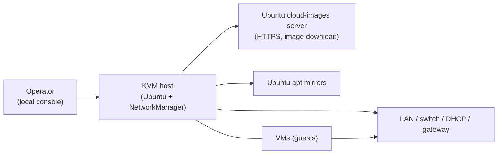
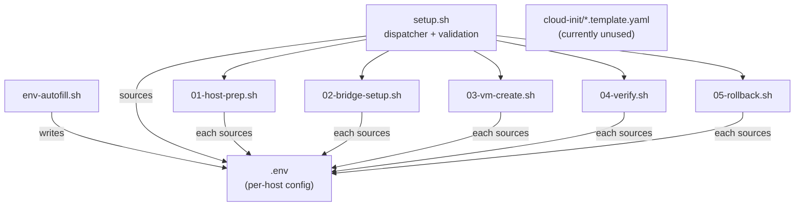

# KVM HA Cluster — Architecture, Part 1 of 4: Foundations

*Purpose, context and logical architecture.*

| | |
|---|---|
| **Version** | 1.0 (describes `main` @ `d273b5e`) |
| **Date** | 2026-11-25 |
| **Series** | KVM HA Cluster — Architecture & Design, Part 1 of 4 |
| **Related** | `docs/TECHNICAL-AUDIT.md` (findings referenced as F-nn) |

[Part 2](part-2-network-and-processes.md) → · [Index](README.md)

---

## 1. Purpose and scope

### 1.1 Purpose
Provide a repeatable, per-host way to turn a stock Ubuntu machine into a KVM hypervisor with **bridged networking**, and to provision cloud-init VMs with static IPs on that bridge, so that VMs on different hosts are peers on the same LAN.

### 1.2 In scope (implemented)
- Host preparation: KVM/libvirt stack, cloud image download.
- Network: replace the host's NetworkManager wired connection with a Linux bridge (`br0`) that clones the NIC's MAC.
- VM provisioning: qcow2 overlay disk, cloud-init seed ISO, `virt-install`, autostart.
- Verification, rollback, and `.env` auto-detection.

### 1.3 Out of scope (not implemented)
Shared storage, cluster membership (Corosync), resource management (Pacemaker), fencing, VM failover, live migration, monitoring, backups. These are the target state in §9.

### 1.4 Goals and design principles

| # | Principle | How it shows up |
|---|---|---|
| P1 | **One codebase, many hosts** | All host-specific values live in an untracked `.env`. |
| P2 | **VMs are LAN peers** | Bridge instead of NAT. |
| P3 | **No secrets in git** | `.env` gitignored; `.env.example` has placeholders only. |
| P4 | **Reversible network change** | Dedicated rollback script restoring the original connection. |
| P5 | **Small, composable steps** | Numbered scripts behind one dispatcher. |

---

## 2. Context

External dependencies: Ubuntu apt mirrors, the Ubuntu cloud-image server, a DHCP server that recognises the host's MAC, and a gateway.

**Assumptions (not enforced by code):** Ubuntu 24.04 (image and `--os-variant ubuntu24.04`), NetworkManager manages the NIC, one wired NIC carries the host's traffic, the host gets its address by DHCP, and the operator has console access during bridge creation.

---

## 3. Logical architecture

### 3.1 Components

| Component | Responsibility | Key inputs | Side effects |
|---|---|---|---|
| `setup.sh` | Parse command, load and validate `.env`, dispatch | `.env`, argv | none itself |
| `env-autofill.sh` | Detect host values and write `.env` | `ip`, `nmcli`, `.env.example` | creates `.env` (0600), may back up and edit `.gitignore` |
| `01-host-prep.sh` | Install the KVM stack, enable libvirtd, fetch image | `CLOUD_IMAGE_*` | apt packages, group membership, image file |
| `02-bridge-setup.sh` | Replace NIC connection with bridge + slave | `PHYS_IFACE`, `OLD_CONN`, `HOST_MAC`, `BRIDGE_IFACE` | NM connections, kernel links, libvirtd enabled |
| `03-vm-create.sh` | One VM end to end | `VM_*`, `IMAGE_DIR`, args | disk, seed ISO, libvirt domain, autostart |
| `04-verify.sh` | Read-only checks | `VMS`, `CLUSTER_*` | none |
| `05-rollback.sh` | Undo the bridge | `BRIDGE_IFACE`, `OLD_CONN` | NM connections, kernel link |

### 3.2 Configuration model

`.env` is a shell file that every script `source`s with `set -a`. It has six groups:

| Group | Variables |
|---|---|
| Host identity | `HOST_NAME HOST_IP HOST_MAC PHYS_IFACE OLD_CONN BRIDGE_IFACE` |
| Network (same on all hosts) | `GATEWAY_IP NETWORK_CIDR DNS_SERVERS` |
| VM defaults | `VM_USER VM_PASSWORD VM_VCPU VM_RAM_MB VM_DISK_SIZE` |
| Image | `CLOUD_IMAGE_URL CLOUD_IMAGE_PATH IMAGE_DIR` |
| This host's VMs | `VMS="name:ip name:ip"` |
| Cluster reference | `CLUSTER_HOSTS`, `CLUSTER_VMS` (`ip:name` lists, used only by verify) |

Lists are space-separated `key:value` pairs parsed with `${entry%%:*}` and `${entry##*:}`.
Only 12 variables are validated by `setup.sh` (F-14).

---

[Part 2](part-2-network-and-processes.md) → · [Index](README.md)
