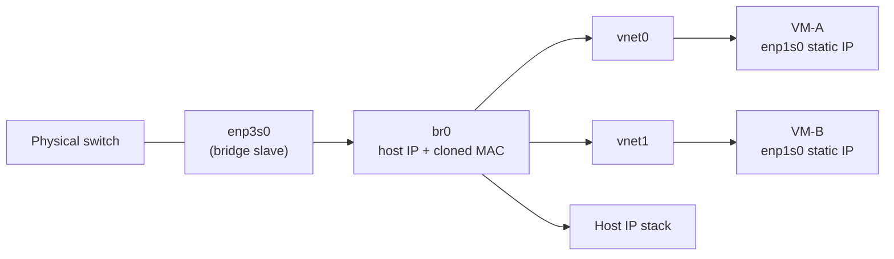
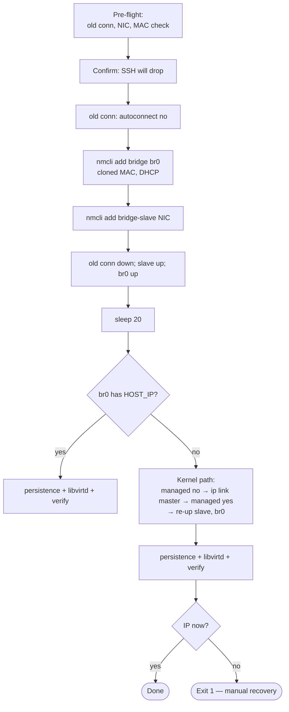
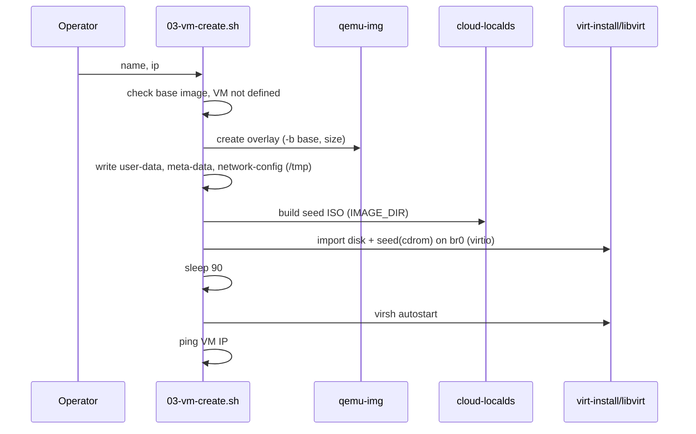

# KVM HA Cluster — Architecture, Part 2 of 4: Network and Processes

*Bridge design, decisions, and the bridge/VM/rollback/verify flows.*

| | |
|---|---|
| **Version** | 1.0 (describes `main` @ `d273b5e`) |
| **Date** | 2026-11-25 |
| **Series** | KVM HA Cluster — Architecture & Design, Part 2 of 4 |
| **Related** | `docs/TECHNICAL-AUDIT.md` (findings referenced as F-nn) |

← [Part 1](part-1-foundations.md) · [Part 3](part-3-deployment-state-security.md) → · [Index](README.md)

---

## 4. Network architecture

### 4.1 Per-host layout

- The NIC carries **no IP**. It is a port of `br0`.
- `br0` holds the host's address (DHCP, IPv6 ignored) and carries the **cloned MAC** of the NIC.
- Each VM's virtio NIC is attached by libvirt as a tap (`vnetN`) on `br0`.
- VM addresses are **static**, set in cloud-init `network-config`.

### 4.2 Cross-host path
All hosts and VMs share one layer-2 segment. A frame from VM-A to a VM on another host leaves `br0` through the NIC, crosses the physical switch, and is delivered by the other host's bridge FDB lookup. No routing and no overlay is involved.

### 4.3 Design decisions

| ID | Decision | Rationale | Trade-off |
|---|---|---|---|
| D1 | Linux bridge, not libvirt NAT | VM↔VM across hosts needs shared L2 | VMs are exposed to the whole LAN (§8) |
| D2 | NetworkManager (`nmcli`), not netplan, for host bridge | Host already uses NM; connection profiles are persistent and scriptable | Ties the design to NM-managed hosts |
| D3 | Clone the NIC's MAC onto `br0` | Keeps the host's DHCP identity/reservation | Needs a DHCP server that tracks that MAC |
| D4 | Host address by DHCP on `br0` | Simple; no per-host static config | IP depends on reservation (open question Q2) |
| D5 | Static IPs for VMs via cloud-init network-config v2 | Predictable addresses, no DHCP dependency | IPs must be assigned and kept unique by the operator |
| D6 | qcow2 overlay on a shared read-only base image | Fast creation, thin disks | Base image is node-local; blocks migration (§9) |
| D7 | Per-host `.env`, sourced as shell | Trivial to read and write | No schema or validation; file is executed |
| D8 | Plain Bash, no config-management tool | Zero dependencies | Imperative, not idempotent (see audit §5) |

### 4.4 Addressing plan (example, from `.env.example`)

| Entity | Address |
|---|---|
| Gateway | `10.0.0.1` |
| Hosts | `.10` host-a, `.11` host-b, `.12` host-c |
| VMs | `.201–.204` on hosts a/b, `.205–.206` on host-c |
| Prefix | `/24`; DNS `8.8.8.8, 8.8.4.4` |

Convention: hosts `.10–.19`, VMs `.201+`. Nothing in code enforces it.

---

## 5. Process views

### 5.1 Bridge creation (`02-bridge-setup.sh`)

Key invariants: the old connection is only disabled **after** pre-flight passes; persistence (`autoconnect`, `autoconnect-slaves`) is set on both success paths; the bridge slave profile is named `bridge-slave-<NIC>` by NetworkManager default, and the script relies on that name.
Known weaknesses: no automatic rollback on exit 1, fixed sleeps rather than polling, and possible STP forwarding delay (audit F-01, F-06).

### 5.2 VM creation (`03-vm-create.sh <name> <ip> [hostname]`)

Artifacts per VM: `IMAGE_DIR/<name>.qcow2`, `IMAGE_DIR/<name>-seed.iso`, a libvirt domain XML, an autostart symlink, and three files in `/tmp` (F-04).
Guest first boot: cloud-init applies hostname, user, password, packages (`openssh-server curl vim net-tools qemu-guest-agent`), and static netplan on `enp1s0`.

### 5.3 Rollback (`05-rollback.sh`)
Down and delete `br0` and the slave profile, detach the NIC (`nomaster`), delete the bridge link, set the NIC to `managed yes`, re-enable autoconnect on `OLD_CONN`, bring it up, then ping the gateway. It does not touch VMs (F-08).

### 5.4 Verification (`04-verify.sh`)
Read-only: bridge state, NM devices, `virsh list`, ping matrix (gateway, `CLUSTER_HOSTS`, `VMS`, `CLUSTER_VMS`), internet ping, SSH hostname probe per VM (key-based, `BatchMode`).

---

← [Part 1](part-1-foundations.md) · [Part 3](part-3-deployment-state-security.md) → · [Index](README.md)
