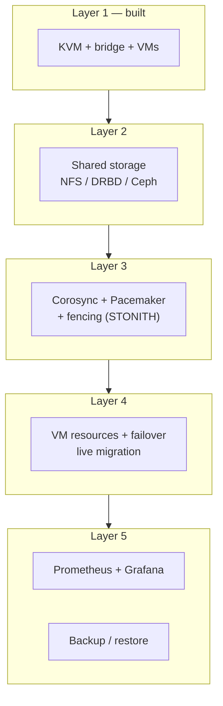

# KVM HA Cluster — Architecture, Part 4 of 4: Target State and Quality

*Roadmap architecture, open decisions, quality attributes, extension points, glossary.*

| | |
|---|---|
| **Version** | 1.0 (describes `main` @ `d273b5e`) |
| **Date** | 2026-11-25 |
| **Series** | KVM HA Cluster — Architecture & Design, Part 4 of 4 |
| **Related** | `docs/TECHNICAL-AUDIT.md` (findings referenced as F-nn) |

← [Part 3](part-3-deployment-state-security.md) · [Index](README.md)

---

## 9. Target architecture (not yet built)

### 9.1 Requirements this design places on the built layer

| Future need | Implication for Layer 1 |
|---|---|
| Live migration | VM disks must be on shared storage, not overlays on a node-local base; stable CPU model (`host-model` or baseline) across hosts |
| Quorum | 3 or more nodes, or 2 plus a quorum device |
| Fencing | out-of-band mechanism (IPMI/iDRAC, smart PDU, or SBD); must be decided before Pacemaker |
| Cluster traffic | dedicated or at least separate network for Corosync and storage is advisable; today only one NIC and one bridge |
| Deterministic VM identity | fixed MAC per VM (derive from IP) |

### 9.2 Open design decisions

| # | Question | Impact |
|---|---|---|
| Q1 | Host OS on all nodes: Ubuntu 24.04 only? | netplan syntax, osinfo, libvirt daemon model |
| Q2 | Is a DHCP reservation guaranteed for each host MAC? | If not, switch `br0` to static addressing |
| Q3 | 2, 3 or more nodes? | quorum design |
| Q4 | Storage: NFS vs DRBD vs Ceph | disk layout, migration, performance |
| Q5 | Fencing device available? | whether HA can be safe at all |
| Q6 | Is the LAN trusted? | whether VM isolation is required |

---

## 10. Quality attributes

| Attribute | Today | Notes |
|---|---|---|
| Repeatability | Medium | same scripts everywhere, but not idempotent |
| Recoverability | Medium | rollback exists; not automatic on failure |
| Portability | Low-medium | Ubuntu + NetworkManager + `enp1s0` assumptions |
| Security | Low | see §8 |
| Observability | Low | console output only |
| Scalability | Medium | per-host copy; VM creation is sequential |
| Maintainability | Medium | small and readable; duplicated cloud-init, no CI |

---

## 11. Extension points

1. **New host:** copy `.env.example`, change identity and VM list. No code change.
2. **New VM profile:** add vars (vCPU, RAM, disk) per VM, for example extend `VMS` entries to `name:ip:vcpu:ram`.
3. **Cloud-init:** make `cloud-init/*.template.yaml` the single source and render with `envsubst`.
4. **New OS image:** parameterise `CLOUD_IMAGE_*` and `--os-variant`.
5. **New command:** add a function to `setup.sh` and a `NN-name.sh` script.

---

## 12. Glossary

| Term | Meaning |
|---|---|
| Bridge (`br0`) | Linux layer-2 switch inside the host |
| Slave / port | An interface attached to a bridge |
| Cloned MAC | `br0` presents the NIC's MAC so DHCP identity is unchanged |
| Overlay disk | qcow2 file that stores only changes over a backing image |
| Seed ISO | CD image carrying cloud-init user-data, meta-data, network-config |
| STONITH / fencing | Forcefully powering off a failed node to protect shared data |
| FDB | Bridge forwarding database (MAC → port) |

---

← [Part 3](part-3-deployment-state-security.md) · [Index](README.md)
